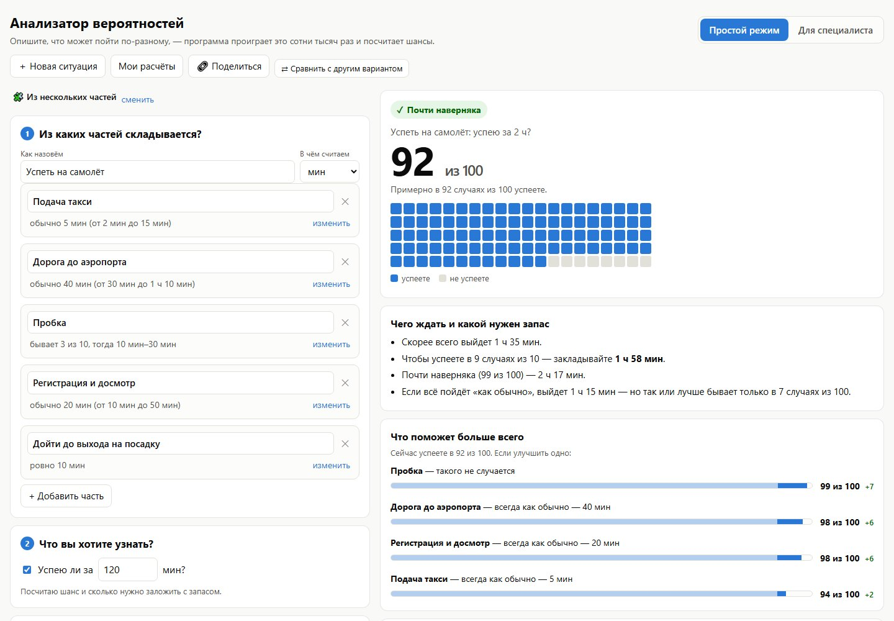
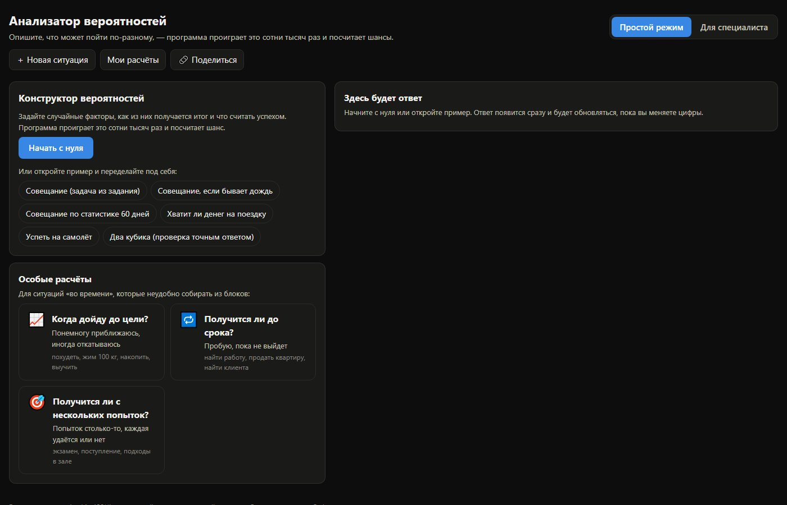
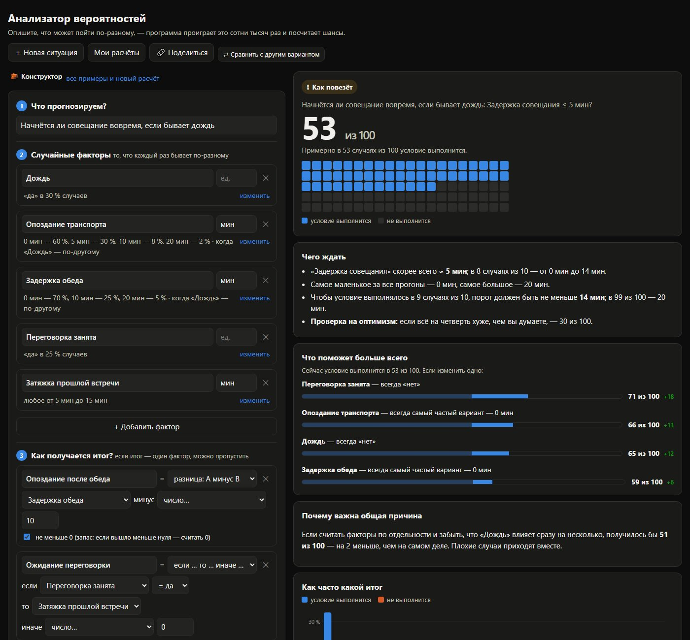

# Анализатор вероятностей

Веб-приложение, которое считает вероятности случайных событий методом Монте-Карло. Пользователь описывает, что может пойти по-разному, задаёт правило, как это складывается в итог, и получает вероятность события с погрешностью, разброс результата и главные факторы риска.

**Демо:** https://maksim-121.github.io/probability-analyzer/ — открывается в браузере, ничего устанавливать не нужно.

> **Учебный проект.** Движок взят из моего слота [Snow Boom](https://github.com/maksim-121/snow-boom): генератор с сидом, выбор по весам, массовый прогон, статистика с погрешностью и сверка с точным ответом. Здесь тот же движок решает бытовые задачи: начнётся ли совещание вовремя, успеет ли доставка, уложится ли проект в срок.

*English summary is at the end of this page.*

**Как проект делался вместе с ИИ-ассистентом Claude** (инструкция, хронология, запросы и промпты, переписка) — в отдельной ветке [`process`](https://github.com/maksim-121/probability-analyzer/tree/process).



## Для кого и зачем

Для обычного человека, которому нужно решить: **успею ли? хватит ли? уложусь ли? сколько закладывать?**
Готовых событий нет — человек описывает свою ситуацию сам, а приложение подсказывает, как.

Приложение — это **универсальный конструктор вероятностей**, как в задании: оно ничего не угадывает,
человек сам собирает свою ситуацию из блоков, поэтому новое условие не «ломает» программу.

1. **Что прогнозируем?** — название своими словами.
2. **Случайные факторы** — всё, что каждый раз бывает по-разному. Для каждого выбирается, как он бывает:

   | Как бывает | Например |
   |---|---|
   | точно | билеты 18 000 ₽ |
   | примерно | обычно 40 мин, бывает от 30 до 70 |
   | любое от–до | затяжка прошлой встречи 5–15 мин |
   | может случиться | пробка ●●●○○○○○○○ 3 раза из 10, тогда +10–30 мин |
   | да / нет | переговорка занята в 25 % случаев |
   | варианты | 0 / 5 / 10 / 20 мин в 50 / 30 / 15 / 5 % случаев |
   | по данным | прошлые значения: 35 42 38 60 41 — или файл CSV из Excel |

   Фактор можно связать с **общей причиной** («когда дождь — по-другому»).
3. **Как получается итог** — расчёты-блоки: сумма, самое большое, самое маленькое, разница (с «не меньше 0»),
   произведение, «если … то … иначе …» или своя формула. Блоки можно ставить друг за другом.
4. **Когда всё хорошо** — условие успеха: «Задержка совещания ≤ 5 мин». Без условия приложение просто покажет, каким бывает итог.

При первом заходе сразу открыт пример из задания — совещание (транспорт, обед, переговорка) — ответ **54 из 100**.
Ещё примеры: совещание с дождём, совещание по статистике 60 дней, поездка, самолёт, два кубика (проверка точным ответом).
Для ситуаций «во времени» остались **особые расчёты**: «Когда дойду до цели?», «Получится ли до срока?», «Получится ли с нескольких попыток?».

Ответ справа — человеческими словами, пересчитывается сам:
- «**54 из 100** — в 54 случаях из 100 «Задержка совещания» не больше 5 мин, то есть **примерно каждый второй раз**»
  и пояснение, как это посчитано;
- **сколько выходит**: «обычно — около 5 мин; в 8 случаях из 10 — от 0 до 13 мин; чтобы условие выполнялось 9 раз из 10,
  порог пришлось бы поднять до 13 мин» и гистограмма с подписью, что значат цвета;
- **что поможет больше всего**: «Если «Переговорка занята» всегда «нет» — 54 → 72 из 100»;
- **проверка на оптимизм**: «если всё на четверть хуже, чем вы вписали, — 33 из 100 вместо 54» (люди обычно оценивают слишком оптимистично);
- **ответ датами** для целей и сроков: «скорее всего к 8 декабря, почти наверняка к 12 января» и график «шанс к каждой дате»;
- **⬇ Скачать отчёт PDF** — сразу скачивается файл на 2 страницы A4: ответ, всё, что задано (факторы и расчёты словами),
  график, советы и метод расчёта. [Пример отчёта](docs/пример_отчёта.pdf). Рядом кнопка 🖨 — напечатать.

Ещё:
- **«Сравнить с другим вариантом»** — варианты А и Б рядом (такси или автобус, 2 или 3 тренировки);
- **«Мои расчёты»** — всё сохраняется в браузере само, можно вернуться и обновить цифры;
- **«Поделиться»** — расчёт зашивается в ссылку;
- **проверка здравого смысла** — «с такими цифрами цель не приближается», «данных мало — ответ примерный».

| Начало: конструктор, примеры, особые расчёты | Цель шаг за шагом: жим 100 кг |
|---|---|
|  |  |

| Совещание с дождём: общая причина | Телефон |
|---|---|
|  |  |

## Пример: начнётся ли совещание вовремя

Совещание в 14:00. Нужны все: Иван едет на автобусе, Мария на обеде, переговорка должна освободиться. «Вовремя» означает задержку не больше 5 минут.

| Фактор | Распределение |
|---|---|
| Опоздание автобуса Ивана | 0 / 5 / 10 / 20 мин с весами 50 / 30 / 15 / 5 |
| Затягивание обеда Марии (у неё 10 мин запаса) | 0 / 10 / 20 мин с весами 60 / 30 / 10 |
| Прошлое совещание в переговорке затянулось | да в 25 % случаев, тогда на 5–15 мин (равномерно) |

Итог: `Задержка = max(Иван, Мария, Переговорка)`, событие: `Задержка <= 5`.

Результат на 1 000 000 прогонов:
- вовремя **53,94 % ± 0,10 %**; точный ответ 0,80 · 0,90 · 0,75 = 54,00 % лежит внутри интервала;
- средняя задержка 6,2 мин, в 10 % дней больше 12,9 мин;
- сильнее всего влияет переговорка: если освобождать её заранее, будет 72 % вместо 54 %.

## Что умеет

- **Факторы семи видов** (внутри — распределения движка): точно; примерно — треугольное «от / обычно / до»; любое от–до — равномерное;
  может случиться — смесь «ничего / сколько-то»; да / нет; варианты с процентами — таблица «значение — вес» (как лента барабана в слоте);
  по данным — выбор из прошлых значений (вписать или загрузить CSV из Excel: русские «;» и «2,5», выбор столбца).
- **Общая причина:** фактор «да / нет» (дождь), от которого другие факторы ведут себя по-другому. Приложение само сравнивает
  ответ с наивным расчётом, где связь забыта, и показывает разницу.
- **Итог из блоков:** сумма, самое большое, самое маленькое, разница (можно «не меньше 0»), произведение, «если … то … иначе …»,
  своя формула на русском (`max(Обед - 10; 0)`, `если(Занята = 1; Затяжка; 0)`) с подсказкой-примерами. При переименовании фактора формулы правятся сами.
- **Ответ:** «N из 100» и 100 точек, итог словами («обычно около 5 мин, в 8 случаях из 10 — от 0 до 13»; большие суммы без ложной
  точности — «62 200 ₽»), какой нужен порог на 9 из 10, «что поможет больше всего», проверка на оптимизм, гистограмма; в подробностях — вероятность с 95 % интервалом
  и точный ответ полным перебором, если все факторы дискретные.
- **Особые расчёты во времени:** когда дойду до цели (вес, жим, накопления — с датами и графиком «шанс к каждой дате»),
  получится ли до срока (поиск работы, продажа), получится ли с нескольких попыток (с точной биномиальной формулой).
  Есть готовые примеры: жим 100 кг, похудение, накопления, поиск работы, собеседования, экзамен.
- Варианты А и Б рядом, «Мои расчёты» (сохраняются сами), «Поделиться» ссылкой.
- **Повторяемость:** генератор с сидом — тот же сид всегда даёт те же самые числа.
- Светлая и тёмная тема, версия для телефона. Миллион прогонов считается меньше чем за секунду.

## Примеры

| Пример | Вопрос | Ответ |
|---|---|---|
| Совещание (задача из задания) | Задержка ≤ 5 мин | 54 из 100 (точно 0,8 · 0,9 · 0,75 = 54 %) |
| Совещание, если бывает дождь | Задержка ≤ 5 мин | 53 из 100 со связью, 51 — если её забыть |
| Совещание по статистике 60 дней | Задержка ≤ 5 мин | 42 из 100 (перебор 42,47 %) |
| Хватит ли денег на поездку | Всего ≤ 70 000 ₽ | 92 из 100 |
| Успеть на самолёт | Всего ≤ 2 ч | 92 из 100 |
| Два кубика | Сумма ≥ 10 | 17 из 100, перебор 36 вариантов = 16,67 % |

Данные «статистики» учебные: они сгенерированы программой ([tools/make_sample_data.py](tools/make_sample_data.py)), это пример формата, а не наблюдения из реального офиса.

## Как проверена математика

| Проверка | Что сравнивается | Итог |
|---|---|---|
| Python-эталон ([reference/](reference/)) | Монте-Карло против точных формул: средние всех распределений, кубики, совещание, зависимости, покрытие 95 % интервала | 54 теста |
| JavaScript против Python ([tests/selftest.html](tests/selftest.html)) | Один генератор в двух реализациях: при одном сиде совпадают все числа до последнего знака | 58 проверок |
| Страница ([tests/uitest.html](tests/uitest.html)) | Сценарии «как пользователь»: пример из задания, расчёт с нуля, своя формула и опечатки в ней, неверная сумма процентов, загрузка CSV, отчёт в PDF, старые сохранения, сравнение вариантов, ссылка, особые расчёты | 54 проверки |

Так же проверялся Snow Boom: две независимые реализации обязаны давать одинаковые числа, а там, где ответ известен точно, Монте-Карло обязан попадать в свою погрешность.


Подробно о методе: [docs/математика.md](docs/математика.md). Устройство программы: [docs/архитектура.md](docs/архитектура.md).

## Как запустить

- **В браузере:** открыть [демо](https://maksim-121.github.io/probability-analyzer/) или скачать репозиторий и дважды щёлкнуть `index.html`. Сервер и интернет не нужны.
- **Тесты** (нужны Python 3 и Chrome или Edge):

```
cd reference
python -m unittest tests_ref          # эталон: 54 теста
python make_vectors.py                # ответы эталона для сверки
cd ..
python tests/run_selftest.py          # движок в браузере: 58 проверок
python tests/run_selftest.py uitest   # страница: 54 проверки
```

## Структура

```
index.html            страница
app/                  интерфейс: app.js (конструктор и ответ), charts.js (графики SVG), csv.js (CSV из Excel, имена для формул)
engine/engine.js      движок: генератор, распределения, язык формул, прогон, статистика, перебор, связи
engine/templates.js   учебные данные для примера «по статистике»
vendor/               jsPDF и html2canvas — только для скачивания отчёта в PDF
reference/            Python-эталон движка и его тесты
tests/                самопроверка движка и страницы в браузере
данные/               учебный CSV со «статистикой» 60 дней
tools/                генератор учебных данных
прототип/             первый прототип на NumPy
docs/                 математика, архитектура, скриншоты
КОНЦЕПЦИЯ.md          как движок слота превратился в анализатор
```

## Технологии

| Часть | Технологии |
|---|---|
| Приложение | HTML, CSS, JavaScript без сборки; графики — SVG; расчёт без библиотек. Для файла PDF — jsPDF 2.5.1 и html2canvas 1.4.1 (MIT, лежат в `vendor/`, интернет не нужен) |
| Генератор | xoshiro128** с начальным состоянием из splitmix32, 53-битные равномерные числа |
| Эталон и тесты | Python 3 (только стандартная библиотека), unittest, Chrome в режиме без окна |
| Прототип, учебные данные | Python, NumPy |

## Ограничения

- Всё считается в браузере, поэтому за раз не больше 5 млн прогонов.
- Общая причина — фактор «да / нет»; других связей между факторами (коэффициентов корреляции) нет.
- Файлы .xlsx напрямую не читаются: из Excel нужно сохранить как CSV.

---

## English summary

**Probability Analyzer** is a browser app that estimates probabilities of real-life events with Monte Carlo simulation. It reuses the engine of my slot game [Snow Boom](https://github.com/maksim-121/snow-boom): a seeded RNG, weighted sampling, mass simulation, statistics with confidence intervals and checks against exact answers.

- The app is a **universal probability constructor** (no topic guessing): add random factors (exact / roughly / any value in a range / may happen / yes-no / options with percentages / past data), optionally tie them to a common cause, combine them into a result with blocks (sum, max, min, difference, product, if-then-else or a custom formula) and set a success condition. The answer is plain: "54 times out of 100", what helps most, an optimism check, and a printable PDF report. Special time-based calculations (goal step by step, until a deadline, several attempts) remain. Variants A/B side by side, saved calculations, share by link.
- Example from the task: will a meeting start on time given transport delays, lunch overruns and a busy meeting room? 54 out of 100, exact answer 0.8 · 0.9 · 0.75 = 54 %.
- Common cause: factors can depend on a yes/no factor ("rain → transport and lunch delays"); the app compares the result with a naive model that ignores the link.
- Results: plain-language answer, probability with a 95 % CI, exact enumeration when all factors are discrete, histogram, what helps most.
- Verification: a pure-Python reference engine is bit-exact with the JavaScript engine (same RNG). 54 Python tests, 58 engine checks and 54 UI checks. How the project was built with the AI assistant Claude is described in the [process](https://github.com/maksim-121/probability-analyzer/tree/process) branch.
- Plain HTML/CSS/JS, no build step, works offline; the only libraries are jsPDF and html2canvas (bundled in `vendor/`) for the PDF report. **Demo:** https://maksim-121.github.io/probability-analyzer/
