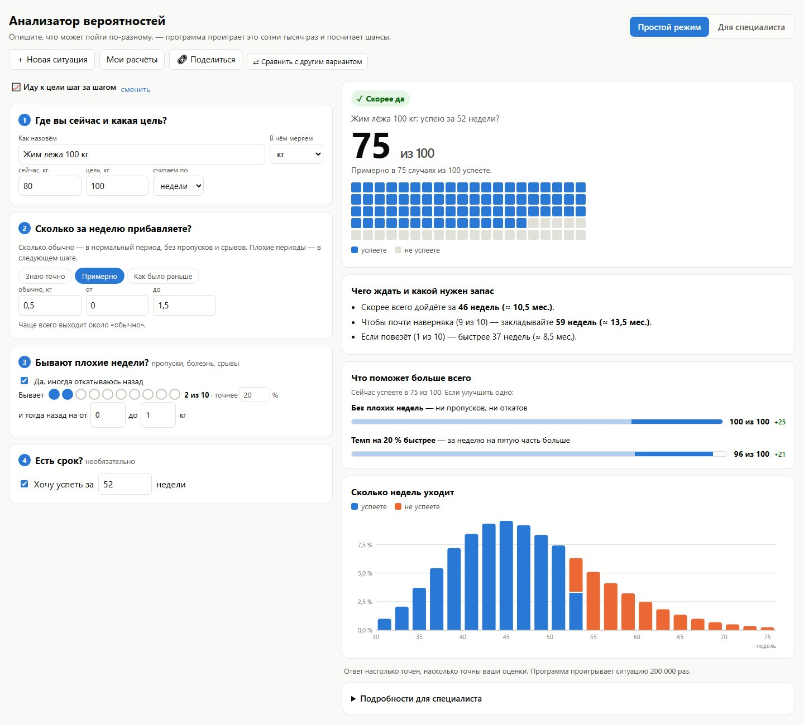
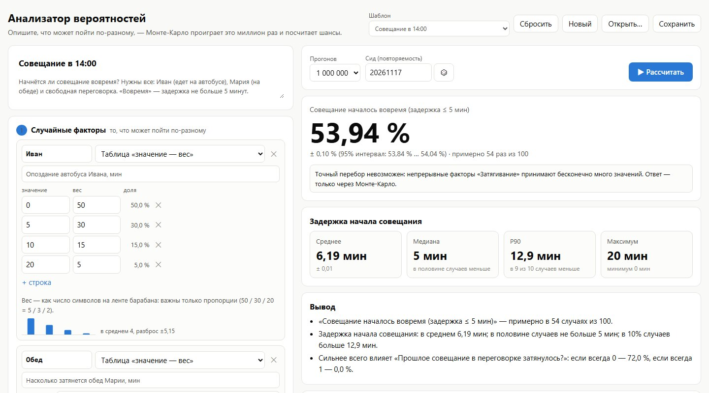
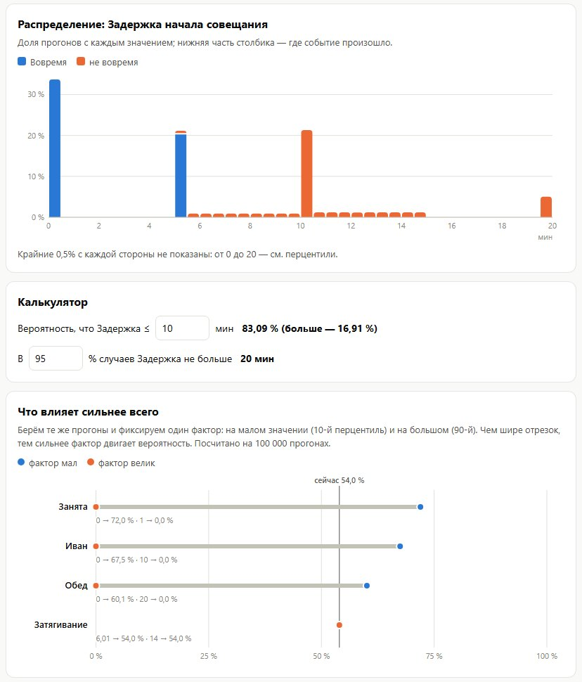
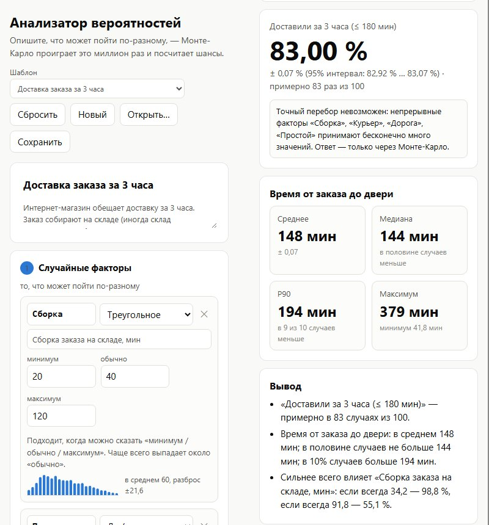
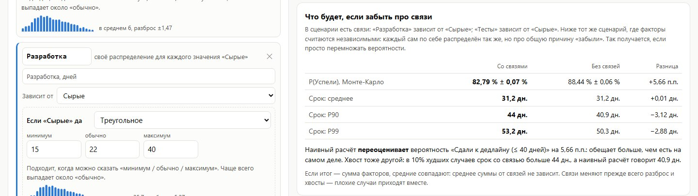
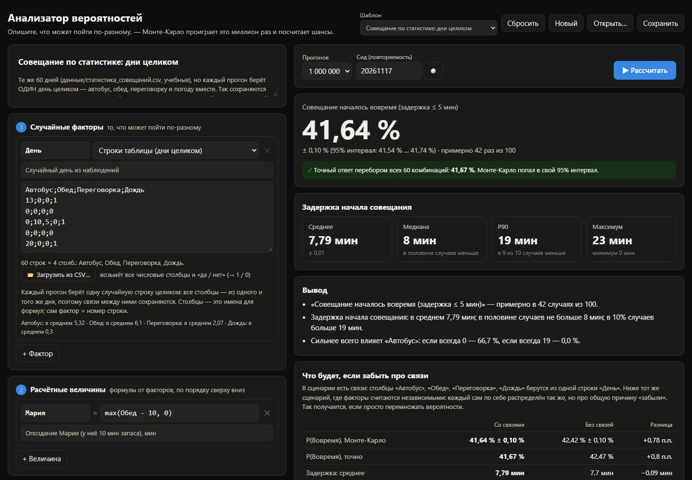
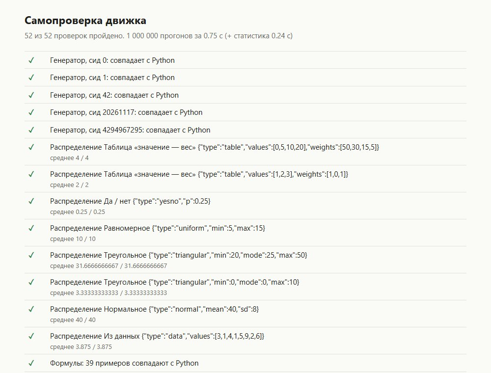

# Анализатор вероятностей

Веб-приложение, которое считает вероятности случайных событий методом Монте-Карло. Пользователь описывает, что может пойти по-разному, задаёт правило, как это складывается в итог, и получает вероятность события с погрешностью, разброс результата и главные факторы риска.

**Демо:** https://maksim-121.github.io/probability-analyzer/ — открывается в браузере, ничего устанавливать не нужно.

> **Учебный проект.** Движок взят из моего слота [Snow Boom](https://github.com/maksim-121/snow-boom): генератор с сидом, выбор по весам, массовый прогон, статистика с погрешностью и сверка с точным ответом. Здесь тот же движок решает бытовые задачи: начнётся ли совещание вовремя, успеет ли доставка, уложится ли проект в срок.

*English summary is at the end of this page.*


## Для кого и зачем

Для обычного человека, которому нужно решить: **успею ли? хватит ли? уложусь ли? сколько закладывать?**
Готовых событий нет — человек описывает свою ситуацию сам, а приложение подсказывает, как.

**Простой режим** (открывается по умолчанию) начинается с вопроса «Какая у вас ситуация?»:

| Схема | Как устроена | Например |
|---|---|---|
| 🧩 Из нескольких частей | части идут друг за другом, время или деньги складываются | успеть на самолёт, бюджет поездки, ремонт |
| 👥 Ждём, пока будет готово всё | всё идёт одновременно, решает самое долгое | встреча, несколько дел сразу |
| 📈 Иду к цели шаг за шагом | каждую неделю понемногу приближаюсь, иногда откатываюсь | жим 100 кг, похудение, накопления |
| 🎯 Несколько попыток | каждая попытка удаётся или нет | собеседования, подходы, экзамены |

Про каждое неизвестное число приложение спрашивает **«Что вы о нём знаете?»** и не требует думать процентами:
- **знаю точно** — «билеты 18 000 ₽»;
- **примерно** — «обычно 40 минут, бывает от 30 до 70»;
- **может случиться** — «пробка бывает ●●●○○○○○○○ 3 раза из 10, и тогда +10–30 мин»;
- **как было раньше** — «последние разы: 35 42 38 60 41» (по прошлым значениям).

Ответ — человеческими словами и единицами, пересчитывается сам:
- «**92 из 100** — почти наверняка успеете»;
- **какой нужен запас**: «чтобы успеть в 9 случаях из 10 — закладывайте **1 ч 58 мин**»;
- «если всё пойдёт как обычно — 1 ч 15 мин, но так бывает только в 7 случаях из 100»;
- **что поможет больше всего**: «Пробка — такого не случается → 99 из 100»;
- для целей — «скорее всего дойдёте за **46 недель (≈ 10,5 мес.)**», для попыток — «нужно примерно 15 собеседований».

Ещё в простом режиме:
- **«Сравнить с другим вариантом»** — варианты А и Б рядом (такси или автобус, 2 или 3 тренировки);
- **«Мои расчёты»** — всё сохраняется в браузере само, можно вернуться и обновить цифры;
- **«Поделиться»** — расчёт зашивается в ссылку;
- **проверка здравого смысла** — «с такими цифрами цель не приближается», «данных мало — ответ примерный».

| Выбор ситуации | Цель шаг за шагом: жим 100 кг |
|---|---|
|  |  |

**Режим специалиста** — полный редактор для преподавателя и сложных случаев: распределения, формулы, зависимости, загрузка CSV,
«торнадо», сходимость, точный перебор. Из простого режима туда ведёт кнопка «Открыть в режиме специалиста» — там тот же расчёт со всеми формулами.

| Режим специалиста | Телефон |
|---|---|
|  |  |

## Пример: начнётся ли совещание вовремя

Совещание в 14:00. Нужны все: Иван едет на автобусе, Мария на обеде, переговорка должна освободиться. «Вовремя» означает задержку не больше 5 минут.

| Фактор | Распределение |
|---|---|
| Опоздание автобуса Ивана | 0 / 5 / 10 / 20 мин с весами 50 / 30 / 15 / 5 |
| Затягивание обеда Марии (у неё 10 мин запаса) | 0 / 10 / 20 мин с весами 60 / 30 / 10 |
| Прошлое совещание в переговорке затянулось | да в 25 % случаев, тогда на 5–15 мин (равномерно) |

Итог: `Задержка = max(Иван, Мария, Переговорка)`, событие: `Задержка <= 5`.

Результат на 1 000 000 прогонов:
- вовремя **53,94 % ± 0,10 %**; точный ответ 0,80 · 0,90 · 0,75 = 54,00 % лежит внутри интервала;
- средняя задержка 6,2 мин, в 10 % дней больше 12,9 мин;
- сильнее всего влияет переговорка: если освобождать её заранее, будет 72 % вместо 54 %.

## Что умеет

- **Сценарий из четырёх шагов:** случайные факторы → расчётные величины → итог → событие. Формулы пишутся на русском: `max(Обед − 10; 0)`, `если(Занята; Затягивание; 0)`, `Задержка <= 5 и не Дождь`.
- **6 распределений:** таблица «значение — вес» (как лента барабана в слоте), да/нет, равномерное, треугольное («минимум / обычно / максимум»), нормальное, из данных.
- **Зависимые факторы:**
  - «Зависит от»: своё распределение для каждого значения причины (в дождь автобус опаздывает сильнее);
  - «Строки таблицы»: каждый прогон берёт один день наблюдений целиком, поэтому связи из данных сохраняются;
  - приложение само сравнивает результат с наивным расчётом, где связи забыты, и показывает разницу.
- **Результат:**
  - вероятность с 95 % интервалом;
  - точный ответ полным перебором, если все факторы дискретные;
  - среднее, медиана, перцентили P1–P99, гистограмма;
  - «торнадо» — какой фактор сильнее всего двигает ответ;
  - график сходимости;
  - калькулятор «P(итог ≤ X)»;
  - вывод простыми словами.
- **Данные:** загрузка CSV из русского Excel (разделитель «;», дробная запятая, кодировка Windows-1251).
- **Файлы:** сохранить и открыть сценарий (.json), скачать сводку для Excel.
- **Повторяемость:** генератор с сидом — тот же сид всегда даёт те же самые числа.
- Светлая и тёмная тема, версия для телефона. Миллион прогонов считается меньше чем за секунду.

## Готовые сценарии

| Шаблон | Вопрос | Ответ |
|---|---|---|
| Совещание в 14:00 | Задержка ≤ 5 мин | 53,9 % (точно 54 %) |
| Два кубика | Сумма ≥ 10 | 16,67 %, перебор 36 комбинаций |
| Совещание по статистике (60 дней) | Задержка ≤ 5 мин | 42,4 % (перебор 42,47 %) |
| Доставка заказа за 3 часа | Время ≤ 180 мин | 83 % |
| Сроки проекта | Срок ≤ 30 дней | 34 %; план «по обычно» в 25 дней выполняется лишь в 6 % случаев |
| Совещание в дождь | Задержка ≤ 5 мин | 52,8 % со связью, 51,2 % если её забыть |
| Совещание по статистике: дни целиком | Задержка ≤ 5 мин | ровно 25 из 60 = 41,67 % |
| Проект: сырые требования | Срок ≤ 40 дней | 82,8 % со связью; наивный расчёт обещает 88,4 % |

Данные «статистики» учебные: они сгенерированы программой ([tools/make_sample_data.py](tools/make_sample_data.py)), это пример формата, а не наблюдения из реального офиса.

## Скриншоты

| Графики: распределение и «торнадо» | Телефон |
|---|---|
|  |  |

**Зависимые факторы и сравнение с наивным расчётом**



**Тёмная тема**



## Как проверена математика

| Проверка | Что сравнивается | Итог |
|---|---|---|
| Python-эталон ([reference/](reference/)) | Монте-Карло против точных формул: средние всех распределений, кубики, совещание, зависимости, покрытие 95 % интервала | 49 тестов |
| JavaScript против Python ([tests/selftest.html](tests/selftest.html)) | Один генератор в двух реализациях: при одном сиде совпадают все числа до последнего знака | 56 проверок |
| Страница ([tests/uitest.html](tests/uitest.html)) | Сценарии «как пользователь» в обоих режимах: опечатки в формулах, неверная сумма процентов, CSV, ветки, сохранение и открытие файлов, все примеры и шаблоны | 93 проверки |

Так же проверялся Snow Boom: две независимые реализации обязаны давать одинаковые числа, а там, где ответ известен точно, Монте-Карло обязан попадать в свою погрешность.



Подробно о методе: [docs/математика.md](docs/математика.md). Устройство программы: [docs/архитектура.md](docs/архитектура.md).

## Как запустить

- **В браузере:** открыть [демо](https://maksim-121.github.io/probability-analyzer/) или скачать репозиторий и дважды щёлкнуть `index.html`. Сервер и интернет не нужны.
- **Тесты** (нужны Python 3 и Chrome или Edge):

```
cd reference
python -m unittest tests_ref          # эталон: 49 тестов
python make_vectors.py                # ответы эталона для сверки
cd ..
python tests/run_selftest.py          # движок в браузере: 56 проверок
python tests/run_selftest.py uitest   # страница: 93 проверки
```

## Структура

```
index.html            страница
app/                  интерфейс: simple.js (простой режим), app.js (режим специалиста), charts.js (графики SVG), csv.js (CSV)
engine/engine.js      движок: генератор, распределения, язык формул, прогон, статистика, перебор, связи
engine/templates.js   готовые сценарии
reference/            Python-эталон движка и его тесты
tests/                самопроверка движка и страницы в браузере
данные/               учебный CSV со «статистикой» 60 дней
tools/                генератор учебных данных
прототип/             первый прототип на NumPy
docs/                 математика, архитектура, скриншоты
КОНЦЕПЦИЯ.md          как движок слота превратился в анализатор
```

## Технологии

| Часть | Технологии |
|---|---|
| Приложение | HTML, CSS, JavaScript без библиотек и сборки; графики — SVG |
| Генератор | xoshiro128** с начальным состоянием из splitmix32, 53-битные равномерные числа |
| Эталон и тесты | Python 3 (только стандартная библиотека), unittest, Chrome в режиме без окна |
| Прототип, учебные данные | Python, NumPy |

## Ограничения

- Всё считается в браузере, поэтому за раз не больше 5 млн прогонов.
- Зависеть можно только от фактора выше по списку, у причины до 12 отдельных значений.
- Связи задаются явно («зависит от») или берутся из таблицы наблюдений. Коэффициентов корреляции между непрерывными факторами нет.

---

## English summary

**Probability Analyzer** is a browser app that estimates probabilities of real-life events with Monte Carlo simulation. It reuses the engine of my slot game [Snow Boom](https://github.com/maksim-121/snow-boom): a seeded RNG, weighted sampling, mass simulation, statistics with confidence intervals and checks against exact answers.

- **Simple mode** for everyone: pick one of four situation types (parts that add up, wait for everything, step by step towards a goal such as a 100 kg bench press, several attempts), describe each number the way you know it (exactly / roughly / may happen N times out of 10 / past values), and get a plain answer: "92 times out of 100", the buffer you need for 9 out of 10, what helps most. Variants A/B side by side, saved calculations, share by link. **Expert mode** keeps the full editor.
- A scenario is built from random factors (6 distribution types), formulas, a result and an event. Example: will a meeting start on time given bus delays, lunch overruns and a busy meeting room? 53.94 % ± 0.10 % on 1M runs, exact answer 54 %.
- Dependent factors: a factor can depend on another one ("rain → bus and lunch delays"), and a dataset can be sampled whole-row so real-world correlations are kept. The app compares the result with a naive model that ignores dependencies. Example: with a common cause the project meets the 40-day deadline in 82.8 % of cases, while the naive model promises 88.4 %.
- Results: probability with a 95 % CI, exact enumeration when all factors are discrete, percentiles, histogram, tornado sensitivity chart, convergence chart.
- Verification: a pure-Python reference engine is bit-exact with the JavaScript engine (same RNG). 49 Python tests, 56 engine checks and 93 UI checks.
- Plain HTML/CSS/JS, no libraries, works offline. **Demo:** https://maksim-121.github.io/probability-analyzer/
