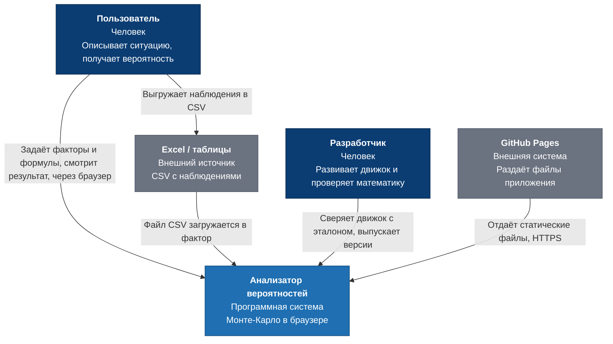
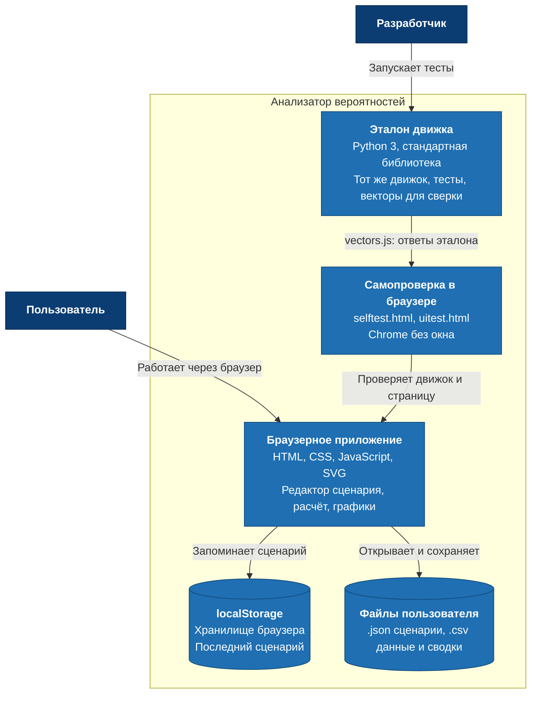
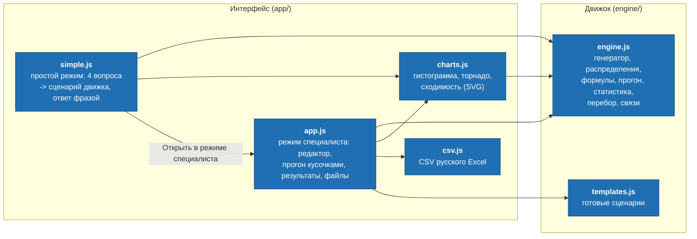

# Архитектура «Анализатора вероятностей»

Описание по модели C4: C1 — система и её окружение, C2 — из каких частей она состоит, C3 — устройство браузерного приложения.

Главная особенность: **сервера нет**. Весь расчёт идёт в браузере пользователя. Эталон на Python запускается только у разработчика, чтобы проверять браузерный движок.

## C1. Контекст системы

Учётных записей, базы данных и внешних API нет. Сценарии хранятся у пользователя: в браузере (последний открытый) и в файлах `.json`.

## C2. Контейнеры

| Контейнер | Технологии | За что отвечает |
|---|---|---|
| Браузерное приложение | HTML, CSS, JavaScript без библиотек | Редактор сценария, Монте-Карло, статистика, графики |
| localStorage | Хранилище браузера | Последний сценарий, чтобы он не пропадал после перезагрузки |
| Файлы пользователя | JSON, CSV | Сценарии, загрузка наблюдений, сводка для Excel |
| Эталон движка | Python 3 | Вторая реализация движка, тесты против точных формул, ответы для сверки |
| Самопроверка | HTML + Chrome без окна | Сверка JavaScript с Python бит в бит и проверка страницы «как пользователь» |

## C3. Компоненты браузерного приложения

**Простой режим** не считает сам по себе: из ответов человека (вид вопроса, пункты, общая причина, порог успеха) он собирает обычный сценарий движка. «Ждём всех» превращается в `max(…)`, «этапы» — в сумму, «иногда случается» — в пару «да/нет + сколько», общая причина — в «зависит от». Поэтому оба режима дают одни и те же числа.

Движок ничего не знает о странице. Его можно подключить в Node.js (`module.exports`) или перенести на сервер без изменений.

**Путь одного расчёта:**
1. `MC.compile(сценарий)` проверяет имена, параметры и формулы и собирает модель. Формулы разбираются собственным парсером в дерево, а дерево превращается в функции. `eval` не используется. Ошибки возвращаются понятным текстом: «Событие «Вовремя», формула «Задерджка <= 5»: неизвестное имя «Задерджка»».
2. `MC.createRun(модель, {n, seed})` готовит прогон, а `step(k)` выполняет следующие k прогонов. Страница считает кусками и между ними обновляет полосу прогресса, поэтому не зависает даже на 5 млн.
3. `MC.summarize` считает вероятность с интервалом, среднее и перцентили. `MC.sensitivity` строит «торнадо», `MC.exact` — точный перебор, если он возможен.
4. Если в сценарии есть связи, `MC.independentVersion` строит тот же сценарий без связей, и он считается тем же сидом для сравнения.

## Основные решения

- **Нет сервера.** Расчёт в браузере быстрый (1 млн прогонов меньше чем за секунду), работает без интернета и раздаётся как статические файлы.
- **Две реализации движка.** JavaScript и Python написаны независимо, но используют один генератор и один порядок случайных чисел. Совпадение до последнего знака доказывает, что обе реализуют одни и те же правила. Python-эталон проверяется против точных формул.
- **Свой язык формул вместо `eval`.** Он безопасен, понимает русские слова (`если`, `и`, `макс`) и даёт понятные сообщения об ошибках.
- **Сид.** Результат воспроизводим, поэтому его можно проверить, приложить к отчёту и повторить.
- **Факторы как «ленты».** Таблица «значение — вес» работает так же, как лента барабана слота, поэтому движок Snow Boom переиспользован почти без изменений в идее.
